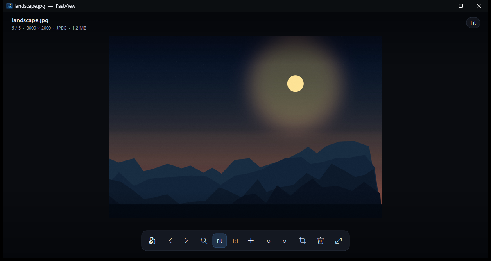

# FastView

A tiny, instant photo viewer for Windows, written in Rust.



**Download:** [FastView Setup (latest release)](https://github.com/sayedmdsafwan/fastview/releases/latest) | MIT licensed | no admin rights needed.

Windows Photos takes a second or more to open, refreshes a lot of UI, and is heavy
on weak laptops. FastView is built the opposite way: one native window, no GPU
initialisation, no framework, no runtime, and pictures decoded on a background
thread while the window is already on screen.

## Why it is fast

- **Native Win32 window** - no UWP, no Electron, no WebView, no toolkit startup.
- **One small background decoder** (WIC, built into Windows) with EXIF orientation.
- **The window paints before the picture is ready** (spinner), so opening feels
  instant even when the disk is busy.
- **Neighbour prefetch** - the previous/next fit previews are prepared while you
  look at the current photo, so the arrow keys feel instant.
- **Pre-rendered fit view** with SIMD resizing (`fast_image_resize`, 4 threads);
  zoom/pan only resizes the visible part at screen resolution.
- **One DIB + one BitBlt per frame** - no GPU device creation, no swap chain, no
  compositor round trips.
- **Nothing runs while idle** - the animation timer stops when nothing moves.

On the author's low-power Pentium Silver N5030 / 8 GB laptop the window appears
in under 0.1 s and a 24 MP JPEG is on screen in roughly 0.3-0.4 s (the first
look, before the look-ahead cache is warm). After that, moving through a folder
is instant.

## Features

- Opens JPG/JPEG, PNG, BMP, GIF, TIFF, WebP, ICO (and HEIC/HEIF/AVIF/JPEG XL when
  the matching Windows codec is installed).
- Folder browsing with natural sorting: next/previous, first/last, arrows,
  Space/Backspace, mouse-wheel zoom at the pointer, drag to pan.
- Fit to window, actual size (100%), zoom from 50% of fit to 1200%.
- Crop with free / 1:1 / 4:3 / 16:9 modes. Saves a **new** file (`_cropped`).
- Rotate left/right. Saves a **new** file (`_rotated`).
- Delete to the Recycle Bin (with an in-app confirmation).
- Copy the current picture to the clipboard.
- Fullscreen, slideshow, in-app shortcut help.
- Drag and drop a picture or folder onto the window.
- Crisp, DPI-aware custom UI; dark title bar; tooltips.
- Adds itself to Explorer's per-user **Open with** list on first launch. It never
  changes the default image app.

## Open with

The installer and the app both register FastView for the common picture types in
`HKCU\Software\Classes`, so no administrator rights are needed:

- an `Applications\fastview.exe` entry with `SupportedTypes`,
- the `FastView.Image` ProgID,
- one `OpenWithProgids` value per supported extension,
- a `RegisteredApplications` / `Capabilities` entry for Settings > Default apps.

The installer does this automatically; there is no checkbox to remember. A
portable copy also registers itself the first time it starts. Windows caches that
list, so if FastView does not show up immediately, close and reopen the picker
(or restart Explorer). The registration is per user and is removed by the
uninstaller.

## Keyboard

| Key | Action |
| --- | --- |
| Left / Right, PgUp / PgDn | Previous / next photo |
| Space / Backspace | Next / previous |
| Home / End | First / last in folder |
| + / -, mouse wheel | Zoom in / out |
| 0 / 1 | Fit window / actual size |
| Double-click | Toggle fit and 100% |
| Drag | Pan a zoomed photo |
| C | Crop |
| Enter / Esc | Apply / cancel crop |
| R / Shift+R | Rotate right / left |
| Del | Delete to Recycle Bin |
| F11 | Fullscreen |
| F5 | Start / stop slideshow |
| Ctrl+O | Open another photo |
| Ctrl+C | Copy the photo |
| F1 / ? | Shortcut help |
| Esc | Leave fullscreen / close help |

## Build

Requirements: Rust stable (MSVC toolchain) and Inno Setup 6 for the installer.

```bat
cargo build --release
```

The executable is `target\release\fastview.exe`. It statically links the C runtime
(`.cargo\config.toml`), so it runs without installing the VC++ redistributable.

### Installer

```bat
"%LOCALAPPDATA%\Programs\Inno Setup 6\ISCC.exe" "E:\Rust Projects\fastview\FastView.iss"
```

The result is `installer\FastView_Setup.exe` (per-user install, no admin needed).
The installer registers FastView in Explorer's *Open with* menu and in Settings >
Default apps. It never changes your default image app.

## Project layout

```
src/main.rs       window procedure, state, input, actions, painting pipeline
src/platform.rs   Win32 helpers: window, dialogs, Recycle Bin, clipboard, fullscreen, Open with
src/imaging.rs    WIC decode + EXIF orientation, SIMD resize, crop/rotate, saving
src/loader.rs     background decode thread, current job + prefetch queue
src/ui.rs         layout, toolbar, overlays, tooltips, help, confirm dialog
src/gfx.rs        software canvas (AA rounded rects, text, spinners) + DIB present
src/library.rs    folder scan and natural sorting
src/timing.rs     optional startup timing (FASTVIEW_TIMING=1)
```

## Debug timings

Set `FASTVIEW_TIMING=1` before launching; a log is written to
`%TEMP%\fastview_timing.txt` with window/show/decode/fit timestamps. It has zero
cost when the variable is not set.

## Tests

Checked on Windows 11 x64 (Pentium Silver N5030, 8 GB): 24 MP JPEG, portrait,
EXIF orientation 6, transparent PNG, broken file, 30-image folder navigation,
crop from 100% zoom, rotate, delete to Recycle Bin, clipboard copy, fullscreen,
slideshow, 50 repeated next/previous steps with stable memory and handles, and a
silent install/uninstall round trip.

## License

MIT. See `LICENSE`.
